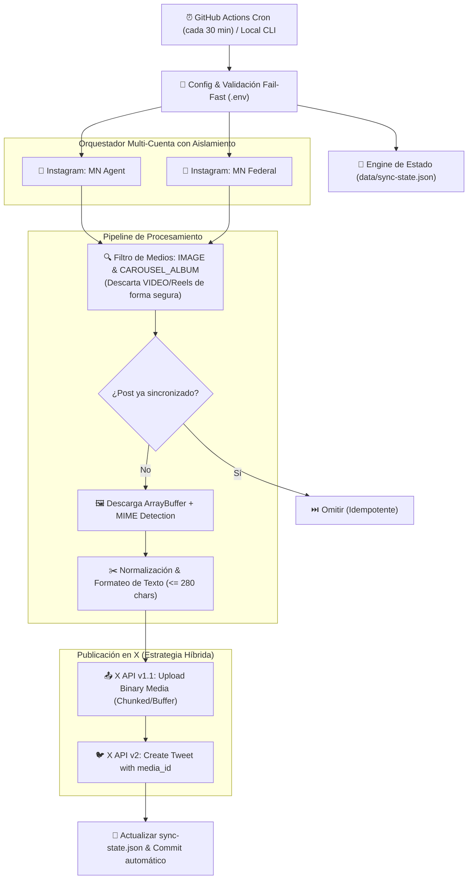

# 🔄 IG-X Sync: Multi-Account Social Automation Engine

> **Automated, production-ready synchronization pipeline connecting multiple Instagram Business accounts to X (Twitter).**  
> Built with TypeScript, Meta Graph API v25.0, X API v1.1/v2, and automated via serverless GitHub Actions cron scheduling.

---

## 🎯 El Problema de Negocio (Caso Real)

Una agencia de marketing y representación gestiona múltiples cuentas comerciales de Instagram con alta frecuencia de publicación. Mantener la presencia activa en X (Twitter) requería duplicar manualmente cada publicación, adaptar textos a la limitación de 280 caracteres y descargar/resubir creatividades en alta calidad.

**Solución desarrollada:**
Un microservicio desacoplado e idempotente que monitorea periódicamente los feeds de Instagram de la agencia, filtra de forma inteligente los formatos compatibles (imágenes individuales y carruseles), adapta los textos dinámicamente y publica el contenido multimedia en X de forma desatendida y sin costo de infraestructura fija.

---

## 🏗️ Arquitectura y Flujo de Datos



---

## 💡 Decisiones Técnicas Destacadas

1. **Estrategia Híbrida de API en X (v1.1 + v2):**  
   La API v2 de X está optimizada para la creación de tweets (`/2/tweets`), pero la subida de binarios multimedia sigue requiriendo los endpoints optimizados de la API v1.1 (`/1.1/media/upload`). El cliente abstrae esta complejidad utilizando `twitter-api-v2` combinando ambas versiones de forma transparente.
2. **Idempotencia sin Costo de Infraestructura:**  
   En lugar de provisionar una base de datos externa para guardar el estado, el servicio utiliza `data/sync-state.json`. Cuando se ejecuta en GitHub Actions, el runner detecta si hubo cambios y realiza un commit automático (`[skip ci]`), manteniendo la persistencia en el propio repositorio de forma serverless y 100% gratuita.
3. **Validación Fail-Fast:**  
   En el arranque del servicio (`src/config/index.ts`), el sistema valida que todas las credenciales requeridas existan y no estén vacías. Si falta alguna variable, el proceso se interrumpe de inmediato con un mensaje descriptivo, evitando errores crípticos a mitad del ciclo.
4. **Tolerancia a Fallos por Cuenta (Fault-Tolerant Multi-Account):**  
   Cada cuenta de Instagram se procesa dentro de su propio límite de error (`try/catch`). Si una cuenta experimenta problemas de permisos o límites de tasa (rate limits), las demás cuentas continúan su sincronización normalmente.
5. **Manejo de Carruseles y Tipos de Medio:**  
   Meta Graph API estructura los álbumes con un array `children`. El servicio resuelve la primera imagen válida de un carrusel manteniendo la consistencia visual y omite limpiamente los videos/reels para evitar fallos por formatos incompatibles en X.

---

## 🗂️ Estructura del Proyecto

```text
ig-x-sync/
├── .github/
│   └── workflows/
│       └── sync.yml            # Automatización CI/CD y Cron Serverless
├── data/
│   └── sync-state.json         # Registro de estado e idempotencia
├── src/
│   ├── config/
│   │   └── index.ts            # Configuración tipada y validación Fail-Fast
│   ├── services/
│   │   ├── instagram.ts        # Meta Graph API v25.0 (feeds, álbumes e imágenes)
│   │   └── twitter.ts          # Integración X API v1.1 + v2
│   ├── utils/
│   │   ├── image.ts            # Descarga de buffer y resolución MIME
│   │   └── state.ts            # Gestor de persistencia de posts sincronizados
│   └── index.ts                # Orquestador principal multi-cuenta
├── .env.example                # Plantilla de variables de entorno
├── package.json                # Scripts y dependencias
└── tsconfig.json               # Configuración TypeScript estricta (Node16)
```

---

## 🚀 Puesta en Marcha Local

### Prerrequisitos
- Node.js >= 18
- Cuenta de Meta for Developers con permisos `instagram_basic` y `pages_read_engagement`
- Cuenta de desarrollador de X (Twitter Developer Portal) con permisos de lectura y escritura (Read and Write)

### 1. Clonar e Instalar Dependencias
```bash
git clone https://github.com/tu-usuario/ig-x-sync.git
cd ig-x-sync
npm install
```

### 2. Configurar Variables de Entorno
Copiá el archivo de ejemplo y completá tus credenciales:
```bash
cp .env.example .env
```

Campos requeridos en `.env`:
```ini
# Meta Graph API
META_ACCESS_TOKEN=tu_token_de_meta
META_GRAPH_API_VERSION=v25.0
IG_MN_AGENT_ID=tu_instagram_account_id_1
IG_MN_FEDERAL_ID=tu_instagram_account_id_2

# X (Twitter) API
TWITTER_API_KEY=tu_api_key
TWITTER_API_SECRET=tu_api_secret
TWITTER_ACCESS_TOKEN=tu_access_token
TWITTER_ACCESS_SECRET=tu_access_secret
```

### 3. Comandos Disponibles

| Comando | Descripción |
|---|---|
| `npm run dry-run` | **Modo Prueba:** Consulta las cuentas, resuelve imágenes y simula el tweet sin publicar ni consumir cuota en X. |
| `npm run dev` | Ejecuta la sincronización completa en modo desarrollo con `ts-node`. |
| `npm run typecheck` | Ejecuta el análisis estático de tipos con TypeScript (`tsc --noEmit`). |
| `npm run build` | Compila el proyecto a JavaScript estándar en `./dist`. |
| `npm start` | Ejecuta el artefacto compilado para producción (`node dist/index.js`). |

---

## ☁️ Despliegue Automatizado (GitHub Actions)

El repositorio incluye un workflow en `.github/workflows/sync.yml` preparado para:
1. Ejecutarse automáticamente cada 30 minutos mediante `cron`.
2. Permitir ejecuciones manuales desde la pestaña **Actions** de GitHub con selector de modo `dry_run`.
3. Guardar el estado actualizado en `data/sync-state.json` mediante un commit desatendido (`[skip ci]`).

### Configuración en GitHub:
1. Andá a tu repositorio en GitHub > **Settings** > **Secrets and variables** > **Actions**.
2. Creá los siguientes Repository Secrets:
   - `META_ACCESS_TOKEN`
   - `IG_MN_AGENT_ID`
   - `IG_MN_FEDERAL_ID`
   - `TWITTER_API_KEY`
   - `TWITTER_API_SECRET`
   - `TWITTER_ACCESS_TOKEN`
   - `TWITTER_ACCESS_SECRET`

---

## 🛡️ Licencia
Distribuido bajo licencia ISC.
