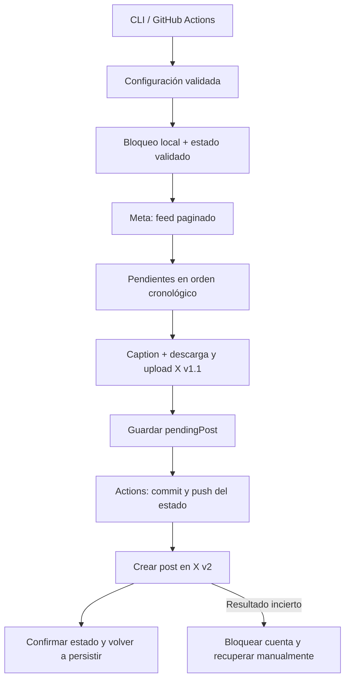

# IG-X Sync

Sincronizador de varias cuentas profesionales de Instagram hacia **una cuenta de X**.
TypeScript estricto, Meta Graph API, OAuth 1.0a de X y ejecución periódica en GitHub Actions.

El caso de uso es evitar que un equipo publique manualmente la misma creatividad en dos
plataformas. El proyecto se concentra en imágenes y en la recuperación segura entre
pollings: procesa pendientes, registra lo publicado y detiene una cuenta cuando el
resultado de una publicación es incierto.

## Probar sin credenciales

Requiere Node.js 22.17+ de la rama 22, o Node.js 24, y Git para las pruebas de integración.

```bash
git clone https://github.com/tomireyes28/ig-x-sync.git
cd ig-x-sync
npm ci
npm run demo
npm test
```

La demo usa feeds sintéticos, un adaptador HTTP en memoria y X simulado. No carga `.env`,
no usa la red y guarda el estado en un directorio temporal que elimina al finalizar.
Muestra preview, primer arranque, dos publicaciones pendientes, reejecución sin duplicados
y una respuesta perdida que bloquea una cuenta mientras la otra continúa.
Los enlaces de X que imprime son ficticios.

## Comportamiento

- **Primer arranque por cuenta:** publica solo el último post elegible, sin importar todo el archivo histórico.
- **Siguientes ejecuciones:** recorre páginas hasta el último ID confirmado y publica pendientes del más antiguo al más nuevo. Omite IDs ya registrados.
- **Formatos:** imágenes individuales y la primera imagen de un carrusel. Omite videos, Reels y carruseles sin imágenes; no replica el álbum completo.
- **Texto:** normaliza a NFC, aplica el conteo ponderado de X y recorta sin separar grafemas ni URLs.
- **Imágenes:** admite JPEG, PNG y WebP de hasta 5 MB, con comprobación de MIME/firma, HTTPS y CDN de Meta/Instagram. No convierte formatos ni decodifica la imagen completa.
- **Fallos:** aísla cada cuenta, devuelve código de salida 1 si alguna falla y conserva los éxitos anteriores.
- **Dry-run:** consulta Meta y muestra captions, sin descargar imágenes, subir media, crear posts ni modificar el estado. Requiere acceso a Meta y puede consumir su cuota.

Si no encuentra el último ID confirmado (por borrado, permisos o más de 20 páginas),
la cuenta falla para revisión. No avanza el checkpoint silenciosamente.

## Arquitectura y decisiones



El archivo JSON evita una base de datos para un volumen pequeño. Las escrituras usan
archivo temporal, flush y reemplazo atómico. Se mantiene compatibilidad de lectura con
el estado original. Un bloqueo exclusivo evita solapamientos en el mismo directorio.

En Actions, la creación en X exige que el registro pendiente ya haya llegado a GitHub.
Si el runner cae después, la siguiente ejecución encuentra ese registro y requiere
reconciliación. Un push rechazado nunca se resuelve con force-push ni con un merge
automático del estado.

Esto **no es una garantía exactly-once distribuida**: X y Git no comparten una transacción.
La estrategia prioriza detenerse y revisar antes que reintentar una creación incierta.
El bloqueo local tampoco coordina máquinas distintas: se debe operar con una única
copia autorizada del estado. Para mayor escala, convendría una base transaccional y una cola.

Los clientes están separados del orquestador y se inyectan como dependencias. Las pruebas
cubren la lógica sin servicios externos, el SDK de X con interceptación previa a la red,
los comandos compilados y un remoto Git local para comprobar checkpoints y conflictos.

## Configuración real

Esta implementación usa **Instagram API with Facebook Login**: una cuenta profesional
conectada a una página, una app de Meta habilitada y un token con acceso a esas cuentas.
Configurá permisos y acceso según la [documentación de Meta](https://developers.facebook.com/docs/instagram-platform/instagram-api-with-facebook-login/).
En X necesitás una app, credenciales OAuth 1.0a de usuario con lectura/escritura y acceso
habilitado a los endpoints usados. Los permisos, cuotas y costos dependen de cada plataforma.

Copiá `.env.example` a `.env` (`Copy-Item .env.example .env` en PowerShell o
`cp .env.example .env` en Bash) y completá:

| Variable | Uso |
| --- | --- |
| `META_ACCESS_TOKEN` | Token de Meta; obligatorio incluso en dry-run. |
| `META_GRAPH_API_VERSION` | Versión de Graph; por defecto `v25.0`, configurable. |
| `IG_ACCOUNT_IDS` | IDs numéricos separados por comas; al menos una cuenta. |
| `IG_MN_AGENT_ID`, `IG_MN_FEDERAL_ID` | Aliases opcionales del caso de uso original; se deduplican con la lista. |
| `TWITTER_API_KEY`, `TWITTER_API_SECRET` | Credenciales de la app de X; solo obligatorias en modo real. |
| `TWITTER_ACCESS_TOKEN`, `TWITTER_ACCESS_SECRET` | Credenciales de usuario de X; un único destino para todas las cuentas. |
| `DRY_RUN` | `true` o `false`; por defecto `false`. `--dry-run` activa siempre el preview. |

Nunca versiones `.env`. El estado contiene IDs, usernames y fechas, pero no tokens.
En un repositorio público esos metadatos también son públicos. El preview imprime captions
en los logs: usalo solo con contenido que pueda verse en ese entorno.

```bash
npm run dry-run
# Para publicar tras revisar el preview, cambiá DRY_RUN=false en .env.
npm run build
npm start
```

## Comandos de desarrollo

| Comando | Función |
| --- | --- |
| `npm run demo` | Demostración offline con datos ficticios y estado temporal. |
| `npm run dry-run` | Preview con Meta real, sin acceder a X ni cambiar el estado. |
| `npm run dev` | Ejecutar con ts-node; respeta `DRY_RUN`. |
| `npm run typecheck` | Verificación de tipos. |
| `npm test` | Build y suite automatizada. |
| `npm run test:coverage` | Suite con cobertura y mínimos de 90% líneas, 80% ramas y 85% funciones. |
| `npm run build` / `npm start` | Compilar / ejecutar; respeta `DRY_RUN`. |
| `npm run recover -- ...` | Resolver una publicación incierta tras verificar X; ver la guía operativa. |

## GitHub Actions

`ci.yml` verifica tipos, pruebas y cobertura en Linux/Windows con Node 22/24. También
valida los workflows con actionlint y consulta avisos de npm. No recibe credenciales de
publicación. Dependabot propone actualizaciones de npm y de Actions.

`sync.yml` opera exclusivamente en la rama por defecto y serializa las ejecuciones.
El cron está definido cada 30 minutos (minutos 7 y 37), pero queda **deshabilitado hasta
configurar la variable de repositorio `SYNC_ENABLED=true`**. El despacho manual usa
`dry_run=true` por defecto. No se activa la publicación al hacer push de esta auditoría.

Para habilitarlo después de integrar los cambios:

1. Agregá los secrets de la tabla anterior en Settings > Secrets and variables > Actions. La versión de Graph es una variable, no un secret.
2. Asegurá que el bot tenga `contents: write` y permiso de push sobre la rama de estado. Una regla de protección que lo impida hará fallar el checkpoint **antes** de crear el post en X.
3. Ejecutá un despacho manual con `dry_run=true` y revisá el resultado.
4. Ejecutá manualmente con `dry_run=false` cuando quieras publicar; activá `SYNC_ENABLED=true` si también querés el cron.

Guarda el estado antes/después de cada creación en X, intenta persistir también tras
fallos parciales y conserva un artefacto de respaldo por 7 días. Los commits del bot usan
`[skip ci]`. Los horarios de GitHub no son una garantía de puntualidad; costos y límites
de Actions y APIs deben revisarse para la cuenta concreta.

## Operación, auditoría y límites

- [Guía de recuperación y diagnóstico](docs/OPERATIONS.md): publicación incierta, locks, estado corrupto y fallos de push.
- [Auditoría y plan por etapas](docs/AUDIT.md): hallazgos, prioridad, correcciones, verificaciones y límites.
- [Reglas de conteo de X](https://docs.x.com/fundamentals/counting-characters) y [media de X](https://docs.x.com/x-api/media/upload-media). El proyecto conserva upload v1.1 + creación v2; X también ofrece endpoints de carga v2.

La auditoría no incluyó publicaciones reales ni validó créditos, permisos o vigencia de
los tokens. El historial JSON crece con los posts sincronizados; el diseño apunta a pocas
cuentas y bajo volumen. La librería oficial `twitter-text` usa una dependencia core-js 2
deprecada; está registrada como deuda de mantenimiento. Un resultado limpio de `npm audit`
solo refleja los avisos conocidos al momento de la consulta.

Licencia [ISC](LICENSE).
